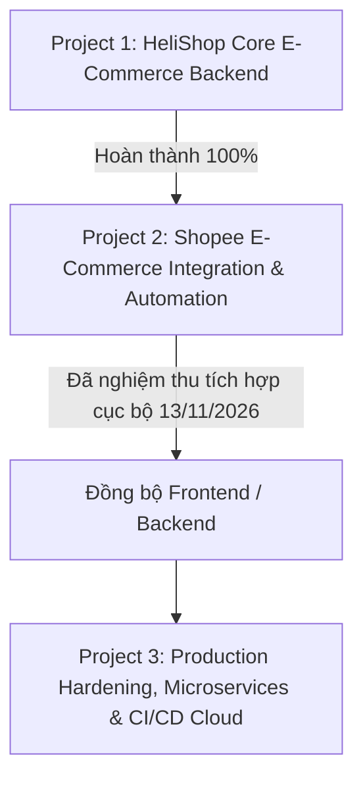

## Admin quản lý tài khoản — 19/11/2026

PR #17 Gmail OTP đã merge, CI 3/3 gồm 20 browser tests. Tiếp tục `feat/admin-account-management`: màn `/admin/users`, tìm/lọc/phân trang, khóa/mở khóa buyer/seller; API kiểm tra admin thực trong DB, giữ nguyên shop/đơn. Thêm auth_version/JWT để vô hiệu phiên cũ ngay khi khóa và không hồi sinh sau mở khóa. Không tạo/xóa admin hay đổi role qua API công khai. [Bàn giao](sprints/admin-account-management.md).

## Gmail OTP, admin và một môi trường Docker — 19/11/2026

Theo yêu cầu: Gmail + mật khẩu; đăng ký bắt buộc OTP gửi Gmail; số điện thoại chỉ dùng trong địa chỉ nhận hàng. Triển khai lần lượt theo nhánh/PR: (1) `feat/gmail-registration-otp`, (2) quản lý tài khoản buyer/seller cho admin, (3) thống nhất một cụm Docker chính dùng volume dữ liệu cũ. Giữ dữ liệu integration, chỉ dùng khi kiểm thử. Chạy kiểm thử, cập nhật tài liệu, push và merge từng phần vào main.

Phần 1: đã thêm API/form OTP, giới hạn gửi/nhập sai, tiêu thụ nguyên tử; bỏ đăng nhập và cập nhật phone ở hồ sơ. Cấu hình gửi Gmail riêng trong `.env.gmail.local`, người dùng sẽ điền; không khẳng định gửi Gmail thật khi chưa có cấu hình. [Chi tiết](sprints/gmail-registration-otp.md).

# LỘ TRÌNH DỰ ÁN TỔNG THỂ: HELISHOP E-COMMERCE

## Kết nối frontend dev/backend — 19/11/2026

Đã sửa proxy Vite khi frontend 5173 dùng backend Docker 18080: cấu hình local chọn cổng, giữ API/ảnh cùng origin và Host đúng cho POST; có template/hướng dẫn, không hardcode cổng Docker vào bản build trình duyệt. 46 frontend tests/build pass; Chrome đăng ký/đăng nhập/catalog/profile qua 5173 pass; backend 183 pass + 1 skip. Nhánh `fix/frontend-dev-backend-proxy` bàn giao PR → main. [Chi tiết](sprints/frontend-dev-backend-proxy.md).

## Seller xử lý đơn — 19/11/2026

Đã nối `/seller/orders` từ shop/header/sản phẩm: danh sách riêng shop, tìm/lọc/phân trang, chi tiết snapshot và thao tác xác nhận → đóng gói → bàn giao → ghi nhận đã giao. Server tính thao tác hợp lệ, khóa order/kiểm tra expectedStatus, chặn sai shop/trạng thái và hoàn kho lặp. VNPAY cần PAID trước đóng gói/giao; IPN không tự đổi bước xử lý. Tiền về sau hủy vẫn được ghi nhận cho đối soát, không mở lại đơn.

Backend **183 pass + 1 schema dev skip**, frontend **45 tests/build pass**, browser **18/18 pass**. IDE vẫn No Problems sau clean nhờ output riêng. Bàn giao nhánh `feat/seller-order-fulfillment` → PR → main. Chưa tích hợp hãng vận chuyển/đối soát COD/refund; không đổi theme. [Chi tiết và giới hạn](sprints/seller-order-fulfillment.md).

## Ổn định môi trường Java — 16/11/2026

Tách đầu ra IDE `.ide-build` khỏi Maven/Docker `target` bằng profile m2e, giữ chẩn đoán thật và auto build. Máy kiểm chứng dùng Red Hat Java Release mới nhất, không pin và bật auto update. Hai lượt clean/build, thêm/sửa/xóa file/package và đối chiếu hash output IDE đã xác nhận Problems 0 mà không cần dọn cache sau clean. Backend 168 pass + 1 MySQL dev skip. Nhánh `fix/java-build-output-isolation` bàn giao qua PR; chi tiết tại [Java IDE](java-ide-troubleshooting.md) và [handover](sprints/java-build-output-isolation.md).

## Sản phẩm/SKU seller — 16/11/2026

Đã nối quản lý sản phẩm/SKU tại `/seller/products`: danh sách riêng shop có phân trang/tìm kiếm/lọc trạng thái; tạo sản phẩm và SKU nguyên tử, sửa thông tin, ẩn/hiện, thêm/sửa SKU và tồn kho. Giá/tổng kho tính từ SKU, sửa biến thể cần version hiện tại, chặn ghi đè số lượng vừa bán. API cũ được bảo vệ để không sửa aggregate của sản phẩm có SKU hoặc mua sản phẩm đã ẩn.

Bàn giao nhánh `feat/seller-product-sku-management` → PR → main. Backend 168 pass, 1 test MySQL dev skip; frontend 40 tests/build và 14 browser E2E pass. Bằng chứng browser/IDE, hợp đồng và giới hạn: [seller-product-sku-management.md](sprints/seller-product-sku-management.md). Giữ theme hiện có; quản lý đơn bán/admin và upload ảnh sản phẩm chờ đợt riêng.

## Mở gian hàng — 14/11/2026

Đã triển khai chức năng mở và xem shop của người bán: đăng ký SELLER → `/seller/shop` → nhập tên/mô tả → lưu shop thật; đăng nhập lại và tải lại trang vẫn đọc shop đã lưu. API GET/POST `/api/v1/shops/me` lấy owner từ JWT đã xác minh, kiểm tra vai trò/trạng thái trong database; khóa tài khoản và unique constraints chống tạo trùng.

Bàn giao nhánh `feat/seller-shop-onboarding` qua PR vào `main`. Kiểm chứng và giới hạn chi tiết: [seller-shop-onboarding.md](sprints/seller-shop-onboarding.md). Chỉ làm mở gian hàng trong đợt này. Quản lý sản phẩm, đơn bán, dashboard và thay đổi theme chờ người dùng yêu cầu tiếp.

## Trạng thái tích hợp — 13/11/2026

Luồng khách hàng đã được kiểm chứng trên Docker cục bộ: catalog → xác thực/OTP → giỏ Redis → địa chỉ/checkout → đơn mua/hủy → Return/IPN → email/ảnh đại diện. Các chức năng 01–09 đã merge qua PR #1–#9; chức năng 10 trên `test/browser-checkout-and-ci` bổ sung browser E2E và ba job CI, bàn giao qua PR riêng.

Kết quả: **152/152 backend tests, 31/31 frontend tests/build, 7/7 browser E2E pass**. Cụm thử web 18000 dùng MySQL, Redis, RabbitMQ, Nginx và Mailpit thật, volume riêng; không thay đổi container dev. Chi tiết từng chức năng và nhánh/PR: [implementation_plan.md](../implementation_plan.md). Tổng kết: [integration-10-browser-ci.md](sprints/integration-10-browser-ci.md).

Đợt này hoàn thành tích hợp cục bộ, chưa nghiệm thu nhà cung cấp thật hoặc phát hành Internet. Không đánh đồng các mốc lịch sử “100%” phía dưới với việc production đã sẵn sàng.

| Phần tiếp theo | Điều kiện |
| --- | --- |
| VNPAY/SMTP/Cloudinary thật | Merchant/secret hợp lệ, callback HTTPS công khai, kiểm chứng giao dịch và lỗi nhà cung cấp |
| Vận hành Internet | Domain/TLS, backup và thử khôi phục, migration schema có kiểm soát, giám sát outbox/DLQ |
| Mở rộng seller/admin | Dashboard, kênh nhận seller-notify, đánh giá/chat/vận chuyển ngoài; lập kế hoạch riêng |
| Thanh toán gộp nhiều shop | Payment-group riêng; hiện hỗ trợ thanh toán từng đơn theo shop |

Các phần Project/Sprint phía dưới lưu lịch sử phát triển. Baseline trước đợt sửa `acdd254` có 103 backend tests và chưa nối giỏ/checkout; trạng thái hiện hành là kết quả ở trên.

---
## 🧭 TỔNG QUAN CÁC GIAI ĐOẠN (PROJECTS)

---

## 🌟 PROJECT 1: CORE E-COMMERCE BACKEND PLATFORM
- **Trạng thái**: ✅ **100% HOÀN THÀNH**
- **Commit Baseline**: `5d0ba9c`
- **Mục tiêu**: Xây dựng nền tảng backend Spring Boot 3.3.5 / Java 21, xác thực JWT, danh mục sản phẩm, khóa bi quan trừ kho và Redis Caching.

| Sprint | Nội dung thực hiện | Thời lượng | Trạng thái |
| :---: | :--- | :---: | :---: |
| **Sprint 1** | Thiết lập dự án, Docker (MySQL + Redis), BaseEntity, User, Shop | 3–4 ngày | ✅ Hoàn thành |
| **Sprint 2** | Spring Security 6, Stateless JWT, Refresh Token Redis, RBAC | 3–4 ngày | ✅ Hoàn thành |
| **Sprint 3** | Quản lý Hàng hóa & Danh mục đa cấp, Dynamic Filter JPA Spec, N+1 Query | 4–5 ngày | ✅ Hoàn thành |
| **Sprint 4** | Đặt hàng an toàn, Khóa bi quan (Pessimistic Lock), Chống âm kho | 3–4 ngày | ✅ Hoàn thành |
| **Sprint 5** | Tối ưu hiệu năng, Redis Distributed Cache, Cache-Aside Pattern | 3–4 ngày | ✅ Hoàn thành |
| **Sprint 6** | Dockerfile Multi-stage, Swagger OpenAPI 100%, Unit & Integration Test | 3–4 ngày | ✅ Hoàn thành |

---

## ⚡ PROJECT 2: SHOPEE E-COMMERCE INTEGRATION & AUTOMATION
- **Trạng thái**: ✅ **100% HOÀN THÀNH TOÀN DIỆN (6/6 Sprints Passed)**
- **Kiến trúc trọng tâm**: Redis Cart Hash Map (TTL 30 ngày), RabbitMQ Message Broker với Dead Letter Queue (DLQ), VNPAY Webhook IPN, Async Email Worker, Media Cloudinary/S3, React 18 Shopee UI, E2E Stress Test 200 Threads & Docker Compose Production.

| Sprint | Nội dung thực hiện | Thời lượng | Trạng thái | Commit / Ghi chú |
| :---: | :--- | :---: | :---: | :--- |
| **Sprint 1** | **Hạ tầng RabbitMQ 3.13, Redis AOF Persistent, Redis Cart Engine Shopee** | 4–5 ngày | ✅ **Hoàn thành** | Commit `fe4d48c` (Đã push lên GitHub) |
| **Sprint 2** | **Cổng thanh toán VNPAY Sandbox, Ký số HMAC-SHA512 & Idempotent Webhook IPN** | 5 ngày | ✅ **Hoàn thành** | Commit `5b5bddb` (Đã push lên GitHub) |
| **Sprint 3** | **Async Email Worker, RabbitMQ Consumer, Retry x3 & Media Upload Cloudinary 1:1** | 4 ngày | ✅ **Hoàn thành** | Commit `4816bc8` (Đã push lên GitHub) |
| **Sprint 4** | **Frontend Core - React 18, Tailwind, Zustand & Axios failedQueue Silent Refresh** | 5 ngày | ✅ **Hoàn thành** | React 18, Vite, Shadcn UI, failedQueue Interceptor |
| **Sprint 5** | **Giao diện Toàn diện Chuẩn Shopee (Màu chủ đạo HeliShop Xanh Biển Ocean Blue)** | 5–6 ngày | ✅ **Hoàn thành** | Header Autocomplete, PDP 2 cấp SKU, Cart phân nhóm Shop, Sticky Checkout, VNPAY & 6 Tab Đơn hàng |
| **Sprint 6** | **End-to-End Testing, CI/CD & Đóng gói Docker Production Toàn diện** | 4 ngày | ✅ **Hoàn thành** | E2E VNPAY & DLQ, 200 Threads Stress Concurrency, Nginx Reverse Proxy & Docker Compose Prod |

---

## 🎯 DEFINITION OF DONE (DOD) CHO TỪNG SPRINT
1. **Mã nguồn sạch**: Biên dịch thành công, không phát sinh cảnh báo quan trọng.
2. **Kiểm thử tự động**: 100% test case (Unit test & MockMvc Integration test) PASSED.
3. **Tài liệu hóa**: Cập nhật Swagger UI, các file Markdown trong `docs/`.
4. **Git Remote Push**: Toàn bộ mã nguồn phải được commit theo chuẩn Conventional Commits và **đẩy trực tiếp lên `origin/main`**.
